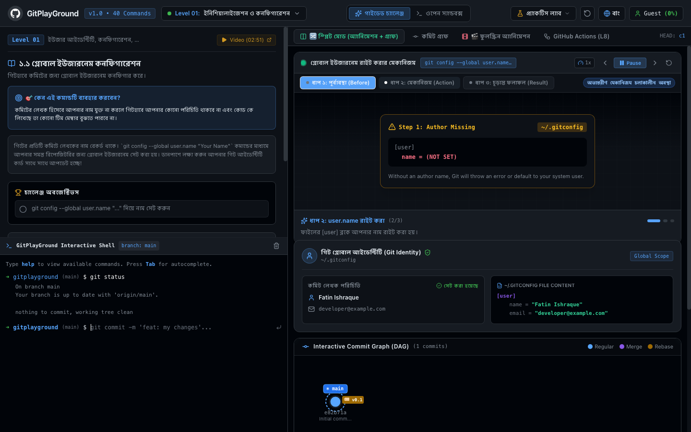

# GitPlayGround

GitPlayGround is an interactive web platform designed to help developers learn and practice Git and GitHub workflows through real-time visual animations and an in-browser simulated terminal.



## What You Can Do

- Practice Git commands in an interactive simulated terminal with real-time feedback.
- Visualize Git internals and commit history using an animated Directed Acyclic Graph (DAG).
- Understand repository lifecycle transitions across the Working Directory, Staging Area, and Local Repository.
- Watch step-by-step visual animations explaining the internal mechanisms behind each command.
- Follow a structured curriculum covering 40 essential Git commands across 8 progressive levels, ranging from initial configuration to advanced rebasing, bisecting, and GitHub CLI workflows.
- Simulate GitHub Actions CI/CD pipelines and practice resolving merge conflicts in an interactive editor.

## Getting Started

### Prerequisites

- Node.js (version 18 or higher)
- npm

### Installation

1. Clone the repository:
   ```bash
   git clone https://github.com/n0vemberain/GitPlayGround.git
   cd GitPlayGround
   ```

2. Install dependencies:
   ```bash
   npm install
   ```

3. Start the local development server:
   ```bash
   npm run dev
   ```

4. Build for production:
   ```bash
   npm run build
   ```

## License

This project is licensed under the MIT License.
